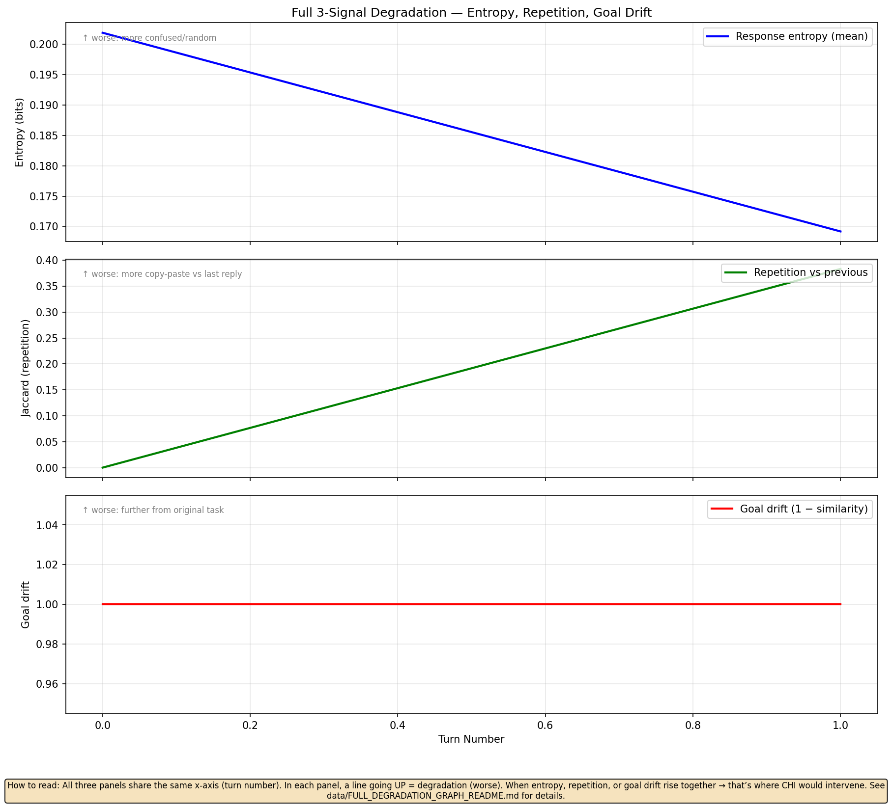

# Cognition Engine

[](https://github.com/Girish011/cognition-engine/actions/workflows/ci.yml)
[](LICENSE)

-black)

**A study of whether a local LLM coding agent can be corrected in the middle of execution — using signals read from its own internals.**

Multi-turn sessions degrade: models repeat themselves, drift off-task and lose coherence. This repo
builds the full loop on Apple Silicon (MLX) and reports honestly what worked:

1. **Measure** cognitive health every turn (entropy, repetition, goal drift → *CHI*, 0-1).
2. **Decide** with an intervention ladder driven by CHI.
3. **Correct** mid-run: activation steering, context compaction, anchor reminders.



*Entropy and goal drift worsen and repetition spikes after ~turn 10. Regenerate with `python scripts/full_degradation_experiment.py`.*

## Result in one paragraph

Health can be read from the model cheaply and it tracks degradation in long chats. Steering can be
injected into MLX models at no measurable cost, but only a narrow band (layer 16, alpha ≈ 0.25-0.5)
is stable. In agent runs, most observed "degradation" turned out to be scaffolding bugs, and once
fixed the test tasks finished before any intervention was needed. The one apparent steering win
was traced to an always-on behavioural prior rather than a CHI-triggered correction. **Mid-run
correction is mechanically feasible; a task-level benefit was not demonstrated.** Full write-up:
[docs/FINDINGS.md](docs/FINDINGS.md).

## Quick start

Requires Apple Silicon macOS and Python ≥ 3.10 for model runs (the parser, memory, session and
steering-math code and its tests also run elsewhere).

```bash
git clone https://github.com/Girish011/cognition-engine.git
cd cognition-engine
pip install -e ".[dev]"

# Chat with live CHI after every reply
python -m cognition_engine chat --model mlx-community/Qwen2.5-Coder-7B-Instruct-4bit

# Run the coding agent on a task (shell commands need approval unless --auto-approve)
python -m cognition_engine agent --task "Create calculator.py with tests" --dir /tmp/demo

# Resume / inspect
python -m cognition_engine agent --dir /tmp/demo --resume
python -m cognition_engine status --dir /tmp/demo
```

### Enabling steering (`--enable-steering`)

Steering vectors are derived data and are not committed. Build them once (needs the model):

```bash
python -m cognition_engine.steering.extract_activations   # data/activations_*.npz
python -m cognition_engine.steering.compute_vectors       # data/steering_vectors/*.npz
python -m cognition_engine agent --task "..." --dir /tmp/demo --enable-steering
```

Without the vectors the agent prints a warning and runs with steering disabled.

## How it works

`CHI = 0.4·entropy + 0.3·repetition + 0.3·goal-drift` (each mapped to a 0-1 health value), with a
per-task drift baseline, a 2-turn cold-start grace and EMA smoothing.

| Level | CHI | Action |
|---|---|---|
| 1 | > 0.8 | normal |
| 2 | 0.5-0.8 | activation steering (alpha scales with how low CHI is) |
| 3 | 0.3-0.5 | context compaction + anchor tokens |
| 4 | < 0.3 | escalation hook (logged only; no cloud call is wired up) |

Details and module map: [docs/ARCHITECTURE.md](docs/ARCHITECTURE.md) · steering notes:
[docs/steering_design.md](docs/steering_design.md).

## Reproducing the experiments

| Script | What it does |
|---|---|
| `scripts/multiturn_entropy.py`, `full_degradation_experiment.py`, `visualize_degradation.py` | 20-turn degradation signals and graphs |
| `scripts/validate_chi.py` | CHI vs the observed inflection point |
| `scripts/steering_experiment.py`, `steering_experiment_v2.py`, `steering_sweep.py` | steering on/off comparisons and the layer × alpha sweep |
| `scripts/test_steering_agent.py` | agent A/B in `baseline`, `steering`, `full_ladder` modes |
| `scripts/run_task047c.sh`, `run_task047d.sh`, `extract_047d_metrics.py` | expense-tracker comparison and replication harness |

Recorded results are in [`data/`](data).

## Tests

```bash
pytest          # pure-Python tests everywhere; MLX tests skip without mlx
```

## Contributing

Contributions and replications are welcome, especially the open experiments in
[docs/FINDINGS.md](docs/FINDINGS.md): a 20-25 turn task that reaches the degradation regime,
steering that switches on only after a CHI drop, other models and other platforms.
See [CONTRIBUTING.md](CONTRIBUTING.md). If you use this work, see [CITATION.cff](CITATION.cff).

## Limitations

Single model (Qwen2.5-Coder-7B 4-bit), single machine, small task set, no statistical claims.
Levels 3-4 never fired in agent runs because tasks completed first. See
[docs/FINDINGS.md](docs/FINDINGS.md#limitations-and-next-experiments) for open experiments.

## License

MIT. See [LICENSE](LICENSE).
